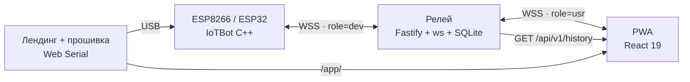
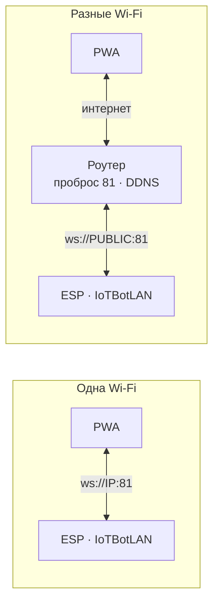

---
tags:
  - iot-messenger
  - architecture
updated: 2026-11-17
---

# Архитектура

## Схема

## Компоненты

| Компонент | Каталог | Роль |
| --- | --- | --- |
| Протокол | `PROTOCOL.md`, `shared/` | контракт, типы, лимиты |
| Релей | `server/` | облачный режим или обход CGNAT; для прямого доступа не нужен |
| Прошивка | `firmware/` | IoTBot (облако), IoTBotLAN (сервер на плате), примеры |
| PWA | `web-app/` | чат, устройства, онбординг, установка |
| Сайт | `landing/` | промо, прошивка из браузера, скачивание PWA |

## Потоки данных

1. Плата подключается к релею: `wss://host/ws?role=dev&token=...`.
2. Телефон подключается к тому же токену: `role=usr`.
3. Релей пересылает `msg`/`cb` между ними и хранит последние 50 сообщений.
4. PWA загружает историю через `GET /api/v1/history?token=...`.
5. При подключении/обрыве платы релей рассылает `status` (online/offline).

## Сервер всегда на ESP

- **Одна Wi-Fi:** сервер на ESP, релей не нужен.
- **Разные Wi-Fi:** сервер всё равно на ESP, но нужен публичный IP и проброс порта.
- **CGNAT:** входящие запрещены — без релея или туннеля не обойтись.

Подробно — [[12 Режимы работы]].

## Топология деплоя

- **GitHub Pages:** сайт `/IOT-MESSENGER/`, PWA `/IOT-MESSENGER/app/`.
- **Netlify:** сайт `/`, PWA `/app/`.
- **Релей:** отдельный Node.js-процесс; нужен только для облачного режима
  или как обход CGNAT. Если у провайдера есть публичный IP, ESP доступна
  напрямую через проброс порта и релей не нужен.
- **Полный self-host:** статику PWA и HTTPS/WSS можно перенести на ESP —
  это следующий шаг ([[12 Режимы работы]]).

## Ключевые ограничения

- Пакет ≤ 1024 байт, текст ≤ 512 байт, клавиатура ≤ 3×3.
- История — 50 сообщений на токен.
- ESP8266 работает только в Wi-Fi 2,4 ГГц.
- LAN-режим: ESP сама поднимает `ws://IP:81`, mDNS `_iotbot._tcp`
  (`IoTBotLAN`).

Связанные заметки: [[02 Протокол]], [[03 Сервер]], [[04 Прошивка]],
[[05 PWA]], [[06 Сайт и деплой]], [[12 Режимы работы]].
