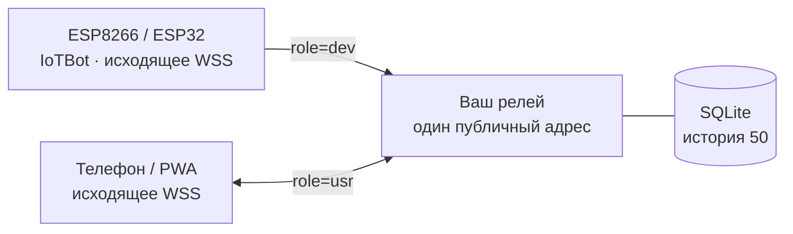
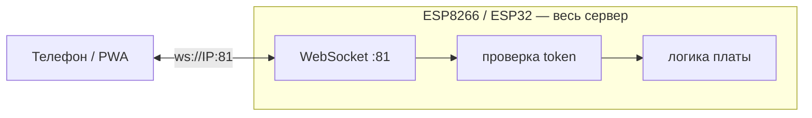
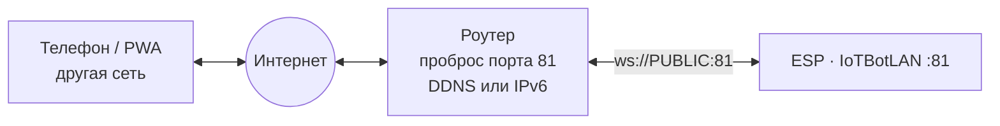
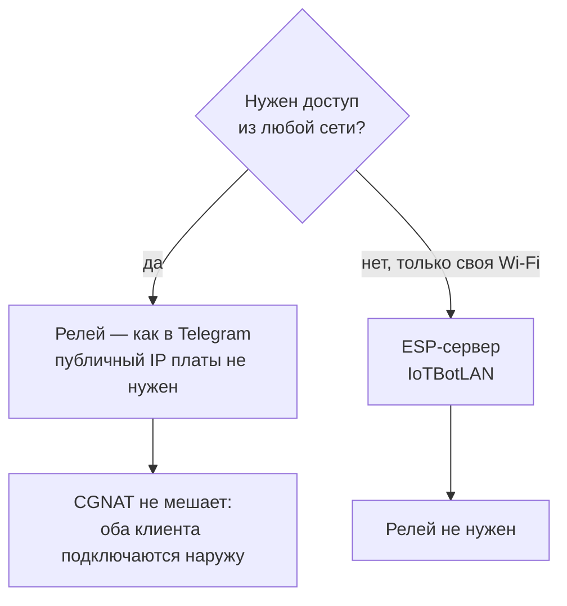

---
tags:
  - iot-messenger
  - architecture
  - modes
updated: 2026-11-17
---

# Режимы работы

## Как в Telegram — через релей

В Telegram и телефон, и бот подключаются **наружу** к серверам Telegram.
Входящие соединения к ним не нужны — поэтому всё работает из любой сети,
через CGNAT и мобильный интернет. У нас устроено так же: плата и PWA сами
открывают WSS к вашему релею.

Что это даёт:

- публичный IP и проброс портов у платы **не нужны**;
- работает из любой Wi-Fi, включая мобильный интернет и CGNAT;
- один релей обслуживает любое число устройств;
- история, `status` и админ-API живут на релее.

Релей — один небольшой Node.js-процесс (`server/`). Ему хватит Raspberry Pi,
домашнего ПК или VPS за несколько долларов. Пошагово:
[[03 Сервер]] и `server/DEPLOY.md` в репозитории.

## Одна Wi-Fi — сервер на ESP

Если интернет и релей не нужны, плата сама поднимает WebSocket.

- без интернета, релея и VPS;
- `IoTBotLAN`, mDNS `_iotbot._tcp`;
- история только в памяти вкладки, админки нет.

## Прямой доступ к ESP из другой сети

Сервер по-прежнему на ESP, но роутер должен пропускать входящие.

Условия: публичный IPv4/IPv6, проброс порта, DDNS. Это **не** модель
Telegram: без публичного IP не работает, а на CGNAT невозможно.

## Что выбрать

## Сравнение

| | Как в Telegram | Одна Wi-Fi | Прямой доступ |
| --- | --- | --- | --- |
| Сервер | релей | ESP | ESP |
| Публичный IP платы | не нужен | не нужен | нужен |
| Проброс порта | не нужен | не нужен | нужен |
| CGNAT | не мешает | — | невозможен |
| Интернет | нужен | не нужен | нужен |
| История | SQLite, 50 | память вкладки | нет |
| Админ-API | есть | нет | нет |
| Сложность | один раз поднять релей | нулевая | настройка роутера |

> [!tip] Рекомендация
> Для «как в Telegram» поднимите релей один раз — например, на Raspberry Pi
> с Cloudflare Tunnel (бесплатно, без публичного IP) или на VPS с Caddy.
> Инструкция: `server/DEPLOY.md`.

Связанные заметки: [[01 Архитектура]], [[02 Протокол]], [[03 Сервер]],
[[04 Прошивка]], [[05 PWA]], [[06 Сайт и деплой]].
