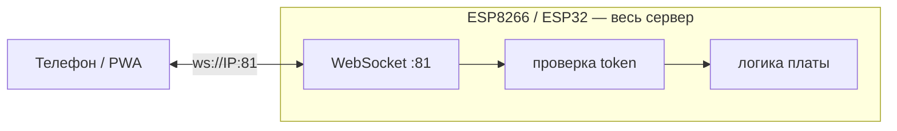
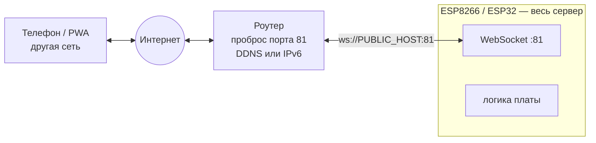
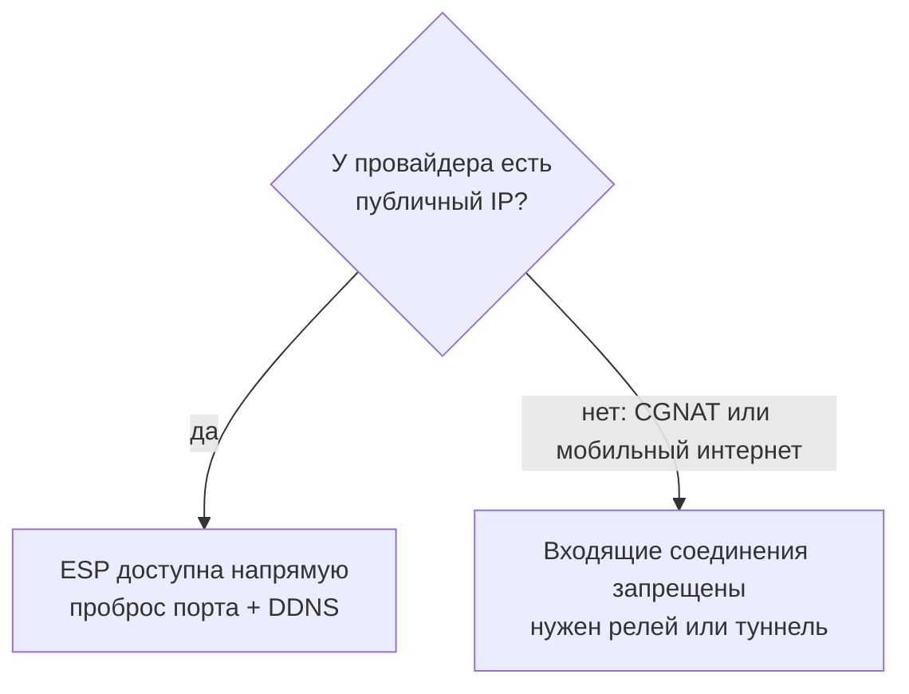

---
tags:
  - iot-messenger
  - architecture
  - modes
updated: 2026-11-17
---

# ESP — единственный сервер

Целевая схема: **релея нет, сервер живёт на ESP**. И в одной Wi-Fi, и в
разных сетях сервером остаётся плата — меняется только путь до неё.

> [!info] Что уже работает
> ESP поднимает WebSocket-сервер на порту 81 (`IoTBotLAN`): проверка токена,
> rate limit, `ping`/`pong`, `status`, mDNS и ваша логика. В одной сети PWA
> подключается напрямую, без интернета и релея.

## Одна Wi-Fi

## Разные Wi-Fi: ESP за роутером

Релея по-прежнему нет: ESP сама принимает входящее соединение. Но нужны
условия со стороны сети:

- публичный IPv4 или IPv6 (не CGNAT);
- проброс порта 81 на IP платы в роутере;
- постоянный адрес: статический IP или DDNS;
- этот адрес введён в PWA как хост устройства.

## Когда без релея физически нельзя

CGNAT — это ограничение сети, а не выбор архитектуры: провайдер не даёт
входящие подключения, поэтому до платы нельзя достучаться снаружи. В этом
случае публичная точка (релей/туннель) неизбежна.

## Что ещё нужно для полного «всё на ESP»

| Вопрос | Сейчас | Чтобы было полностью на ESP |
| --- | --- | --- |
| WebSocket-сервер | на ESP | готово |
| Логика платы | на ESP | готово |
| Проброс порта / DDNS | настраивается вручную | инструкция + подсказка в PWA |
| Статика PWA | GitHub Pages / Netlify | отдавать с ESP (LittleFS) |
| HTTPS / WSS | нет | TLS-сервер и сертификат на ESP |
| Установка PWA | на HTTPS-хостинге | нужен HTTPS на ESP |

Главный нюанс: если PWA открыта по HTTPS, браузер блокирует `ws://` как
mixed content. Поэтому «всё на ESP» требует одного из двух:

1. открывать PWA по `http://` — просто, но небезопасно и без установки PWA;
2. поднять на ESP HTTPS/WSS с доверенным сертификатом и отдавать PWA с платы.

## Сравнение

| | Одна Wi-Fi | Разные Wi-Fi + публичный IP | CGNAT |
| --- | --- | --- | --- |
| Сервер | ESP | ESP | ESP |
| Релей | нет | нет | нужен |
| Интернет | не нужен | нужен | нужен |
| Проброс порта | не нужен | нужен | бесполезен |
| HTTPS-PWA | блокирует `ws://` | нужен WSS | нужен WSS |

## Что делать дальше

- [ ] Инструкция: проброс порта + DDNS для популярных роутеров.
- [ ] PWA: подсказка «укажите публичный адрес платы».
- [ ] Отдача PWA с ESP через LittleFS (без GitHub Pages).
- [ ] HTTPS/WSS на ESP с сертификатом (Let's Encrypt или самоподписанный).

Связанные заметки: [[01 Архитектура]], [[02 Протокол]], [[03 Сервер]],
[[04 Прошивка]], [[05 PWA]], [[06 Сайт и деплой]].
